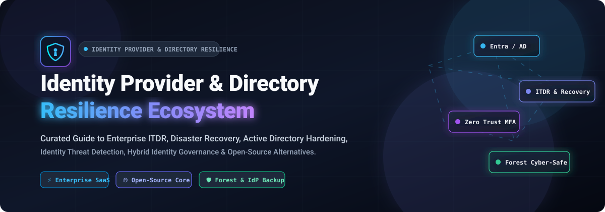
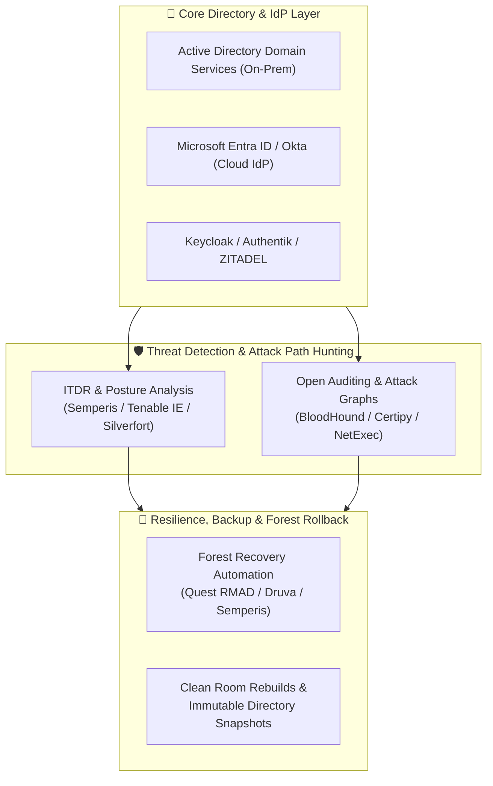

  

# 🛡️ Awesome Identity Provider & Directory Resilience    

> 🚀 A curated list of top **Identity Provider (IdP) & Directory Resilience** solutions, Identity Threat Detection & Response (ITDR), Active Directory forest recovery platforms, identity governance, zero-trust access, and battle-tested **open-source identity projects**.

---

## 📑 Table of Contents
- [📌 Sector Overview & Market Dynamics](#-sector-overview--market-dynamics)
- [🏢 SaaS & Hosted Platforms](#-saas--hosted-platforms)
- [🔓 Open-Source GitHub Projects](#-open-source-github-projects)
- [🛠️ Architecture & Resilience Stacks](#️-architecture--resilience-stacks)
- [🤝 How to Contribute](#-how-to-contribute)
- [💖 Support](#-support)
- [📈 Star History](#-star-history)
- [📜 Disclaimer](#-disclaimer)

---

## 📌 Sector Overview & Market Dynamics

The global **Identity & Access Management (IAM) and Identity Resilience (ITDR)** market is estimated at **$25.0B - $30.0B**, rapidly accelerating at a **~23.6% CAGR** toward **$40B+** driven by cloud identity threats, ransomware targeting directory infrastructure, and Zero Trust requirements. The market is **moderately fragmented**: while foundational identity directory control planes remain concentrated among tech giants like Microsoft and Okta, the cyber resilience, Active Directory disaster recovery, and Identity Threat Detection & Response (ITDR) layers remain a vibrant, highly fragmented ecosystem of specialized security vendors and community open-source projects.

---

## 🏢 SaaS & Hosted Platforms

A comprehensive breakdown of enterprise SaaS platforms specializing in identity resilience, directory protection, privileged access recovery, and ITDR. Sorted in descending order by enterprise company size (market cap / valuation / ARR scale).

| 🏢 Product | 🌐 Focus Area | 💰 Pricing (Starting Tier) | 🎁 Free Tier / Trial Limits | 📊 Company Size (Valuation / Rev) |
| :--- | :--- | :--- | :--- | :--- |
| **[Microsoft Entra ID Protection](https://www.microsoft.com/en-us/security/business/identity-access/microsoft-entra-id-protection)** | Risk-based Conditional Access, Identity Governance & Threat Detection | **$10.00 / user / month** (Entra ID Premium P2 plan; bundled in M365 E5) | 30-day free trial (includes full P2 capabilities for up to 100 users) | **~$3.5T Market Cap** (~$281B+ Ann. Revenue) |
| **[CyberArk Identity](https://www.cyberark.com/products/identity-management/)** | Workforce Identity, Adaptive MFA, SSO & Identity Threat Defense | **$4.00 / user / month** (Workforce Identity SSO & MFA base tier) | 14-day free trial (complete virtual lab and administrative sandbox) | **$21.1B Valuation** (~$1.0B+ Ann. Revenue) |
| **[Okta Identity Threat Protection](https://www.okta.com/products/identity-threat-protection/)** | Real-time continuous session evaluation & Identity Threat Detection (ITDR) | **$6.00 / user / month** (Workforce Starter; Professional ITDR tier via custom quote) | 30-day free trial (full enterprise workforce trial with Universal Directory) | **~$12.5B Market Cap** (~$2.6B+ Ann. Revenue) |
| **[Quest Recovery Manager for AD](https://www.quest.com/products/recovery-manager-for-active-directory/)** | Automated Active Directory forest disaster recovery & ransomware rollback | **$20.00 / managed user / year** (~$1.67/user/mo equivalent on DR edition) | 30-day free trial (full-featured on-prem / hybrid lab evaluation) | **$5.4B Enterprise Value** (~$850M+ Ann. Revenue) |
| **[Tenable Identity Exposure](https://www.tenable.com/products/tenable-identity-exposure)** | Continuous Active Directory security posture & attack path hunting | **$3.50 / enabled identity / month** (Available via Tenable One exposure units) | 14-day assisted proof-of-concept trial (full directory vulnerability scan) | **~$4.4B Market Cap** (~$994M+ Ann. Revenue) |
| **[SailPoint Identity Security](https://www.sailpoint.com/)** | Enterprise Identity Governance, Access Insights & Compliance Resilience | **$5.00 / managed identity / month** (Billed annually starting at $60/identity/yr) | 0 days (No self-serve trial; enterprise sales-assisted POC upon qualification) | **~$4.0B+ Private Valuation** (~$877M+ Ann. ARR) |
| **[Ping Identity (PingOne)](https://www.pingidentity.com/)** | Cloud Workforce & Customer Identity orchestration, risk scoring & SSO | **$3.00 / user / month** (PingOne Workforce Essential tier starting rate) | 30-day free trial (full cloud sandbox supporting up to 1,000 active users) | **$2.8B Acquisition Value** (~$350M+ Ann. Revenue) |
| **[Druva Identity Resilience](https://www.druva.com/solutions/identity-resilience)** | Cloud-native Entra ID, Okta & Active Directory immutable backup & recovery | **$4.00 / user / month** (Druva SaaS Data Protection / Essentials starter pack) | 30-day free trial (full cloud access, zero hardware required, no credit card) | **$2.0B Private Valuation** (~$300M+ Ann. ARR) |
| **[BeyondTrust Privilege Management](https://www.beyondtrust.com/)** | Privileged Access Management (PAM), credential vaults & identity isolation | **$1,995 / month** (Base enterprise module starter tier; ~$18k+/yr typical contract) | 30-day free trial (unlimited evaluation features for remote access/PAM) | **$1.5B+ Valuation** (~$500M+ Ann. ARR) |
| **[Semperis Directory Services Protector](https://www.semperis.com/directory-services-protector/)** | Purpose-built Active Directory & Entra ID threat mitigation and rapid forest recovery | **$4.50 / user / month** (Enterprise annual subscription quote based on active identities) | Free assessment tool (*Purple Knight* & *Forest Druid* free forever) + 14-day DSP POC | **$1.0B+ Centaur Valuation** (~$100M+ Ann. ARR) |
| **[Silverfort Identity Protection](https://www.silverfort.com/)** | Unified Identity Threat Detection & Response across hybrid AD and multi-cloud IdPs | **$5.00 / user / month** (Core tier subscription based on directory headcount) | 14-day free trial / guided proof-of-concept upon enterprise request | **$1.0B Unicorn Valuation** (~$82M+ Ann. Revenue) |

---

## 🔓 Open-Source GitHub Projects

Explore the most capable open-source Identity Providers, directory management systems, Active Directory analysis frameworks, and resilience utilities. Sorted in descending order by GitHub Stars ⭐.

| 📦 Repository | ⭐ Stars | 📝 Description | 🎯 Resilience & Identity Capabilities |
| :--- | :--- | :--- | :--- |
| **[Keycloak](https://github.com/keycloak/keycloak)** |  | Open Source Identity and Access Management for Modern Applications and Services | Centralized SSO, user federation (LDAP/AD), fine-grained authorization, and identity brokering. |
| **[Authelia](https://github.com/authelia/authelia)** |  | Single Sign-On Multi-Factor authentication companion for reverse proxies | Hardened multi-factor authentication portal (WebAuthn/TOTP/Duo) with LDAP/AD backend pass-through. |
| **[Authentik](https://github.com/goauthentik/authentik)** |  | Modern open-source Identity Provider emphasizing flexibility and enterprise integrability | Outpost architecture, user enrollment, directory synchronization, SCIM support, and MFA flows. |
| **[ZITADEL](https://github.com/zitadel/zitadel)** |  | Cloud-native multi-tenant identity infrastructure written in Go | Event-sourced architecture ensuring complete audit trails, high availability, and passwordless login. |
| **[Casdoor](https://github.com/casdoor/casdoor)** |  | UI-first IAM platform with LLM MCP & agent gateway support | Comprehensive protocol support (OAuth 2.0, OIDC, SAML, CAS, LDAP, SCIM) with automated directory syncing. |
| **[Ory Kratos](https://github.com/ory/kratos)** |  | Headless cloud-native identity management and authentication system | Extreme-scale user authentication, session state management, account recovery, and security hardening. |
| **[Apereo CAS](https://github.com/apereo/cas)** |  | Enterprise Single Sign-On engine for universities, governments, and corporations | Proven multi-datacenter SSO, credential delegation, password management policies, and AD integration. |
| **[Dex IdP](https://github.com/dexidp/dex)** |  | OpenID Connect (OIDC) identity provider with pluggable directory connectors | Delegates authentication to SAML, LDAP, and OAuth backends, acting as an immutable identity gateway. |
| **[BloodHound (Legacy / CE)](https://github.com/SpecterOps/BloodHound-Legacy)** |  | Graph theory-based Active Directory security mapping and relationship analyzer | Uncovers hidden administrative relationships, privilege escalation paths, and misconfigured ACLs in AD. |
| **[NetExec](https://github.com/Pennyw0rth/NetExec)** |  | Automated network service and Active Directory audit execution framework | Automated validation of AD credentials, SMB share exposure, and lateral movement attack paths. |
| **[Certipy](https://github.com/ly4k/Certipy)** |  | Active Directory Certificate Services (AD CS) enumeration and audit tool | Identifies vulnerable certificate templates, ESC misconfigurations, and unauthorized CA certificate issue paths. |
| **[FreeRADIUS](https://github.com/FreeRADIUS/freeradius-server)** |  | High-performance open-source multi-protocol network access and authentication server | Robust enterprise network authentication, IEEE 802.1X, and directory federation policy enforcement. |
| **[BloodyAD](https://github.com/CravateRouge/bloodyAD)** |  | Lightweight Active Directory privilege escalation and object security framework | Audits and interacts directly with AD through LDAP to detect and mitigate dangerous object write permissions. |
| **[Certify](https://github.com/GhostPack/Certify)** |  | C# auditing toolkit for Active Directory Certificate Services vulnerabilities | Scans directory forests for privilege escalation paths via misconfigured AD CS templates. |
| **[mitm6](https://github.com/dirkjanm/mitm6)** |  | Assessment tool for Windows default IPv6 DHCP DNS takeovers | Identifies vulnerabilities in default Windows AD domain client name resolution configs. |
| **[ldapdomaindump](https://github.com/dirkjanm/ldapdomaindump)** |  | Active Directory information dumper via authenticated LDAP | Generates offline HTML/JSON identity maps, group memberships, and trust relationships for audits. |
| **[FreeIPA](https://github.com/freeipa/freeipa)** |  | Integrated identity, policy, and trust management solution for Linux / Unix | Centralized Kerberos, 389 Directory Server (LDAP), DNS, and Active Directory cross-forest trust setup. |
| **[Janssen Project](https://github.com/JanssenProject/jans)** |  | High-performance open-source IAM distribution by the Linux Foundation | Cloud-native Auth Server, Agama low-code identity journey builder, and Cedarling policy engine. |
| **[OpenDJ](https://github.com/OpenIdentityPlatform/OpenDJ)** |  | Enterprise-grade Java LDAP directory server with multi-master replication | High-performance directory service providing resilient, real-time replication for enterprise identity storage. |
| **[oxAuth](https://github.com/GluuFederation/oxAuth)** |  | Hardened OAuth 2.0 and OpenID Connect Authorization Server | Standard-compliant identity transaction engine with extensive support for FIDO2 and biometric workflows. |

---

## 🛠️ Architecture & Resilience Stacks

Building a robust, cyber-resilient identity architecture requires defense-in-depth across the identity lifecycle:

### 💡 Resilience Blueprint:
1. **Immutable Directory Backups:** Ensure offline, unalterable Active Directory snapshots with tools like **Quest RMAD Disaster Recovery Edition** or **Druva Cyber Resilience** to protect against wiper malware.
2. **Attack Path Reduction:** Continuously map privilege escalation chains with **BloodHound** and eliminate misconfigured AD CS templates using **Certipy**.
3. **MFA Hardening & Zero Trust:** Enforce phishing-resistant WebAuthn/FIDO2 authentication via **Authelia**, **Authentik**, or **CyberArk** to neutralize credential harvesting.
4. **Active Threat Detection (ITDR):** Monitor domain controller replication traffic and Kerberos ticket requests in real-time with **Microsoft Entra ID Protection** and **Semperis DSP**.

---

## 🤝 How to Contribute

Contributions are warmly encouraged! To propose a new SaaS solution or open-source tool:

1. 🍴 **Fork the repository**.
2. 🌿 Create a descriptive branch: `git checkout -b add-identity-tool`.
3. 📝 Update `README.md` following the established table structure.
   - For SaaS products, verify pricing and free trial details from official sources.
   - For Open-Source projects, include repository links and official star badges (`style=social&color=white`).
4. 🚀 Commit your changes: `git commit -m "Add New-Identity-Tool to curated list"`.
5. 📤 Push to your fork: `git push origin add-identity-tool`.
6. 🔀 Submit a **Pull Request** detailing why the tool qualifies for inclusion.

---

## 💖 Support

If you find this directory resilience and identity provider guide helpful, please consider supporting the project:

- ⭐ **Star this repository** to help others discover it!
- 🍴 **Fork and share** with your cybersecurity and DevSecOps peers.
- ☕ **Buy me a coffee**: Sponsor development and ongoing maintenance via the [GitHub Sponsor Dashboard](https://github.com/sponsors/ishandutta2007).

---

## 📈 Star History

---

## 📜 Disclaimer

- This repository is a community-curated educational and technical resource; it does not constitute formal cybersecurity endorsement.
- All product names, logos, and trademarks are property of their respective owners.
- Pricing, trial tiers, and enterprise valuations are compiled from publicly available data and are subject to change by vendors without prior notice.

---

  <b>Built with ❤️ for Security Architects, Sysadmins, and Identity Engineers worldwide.</b>

